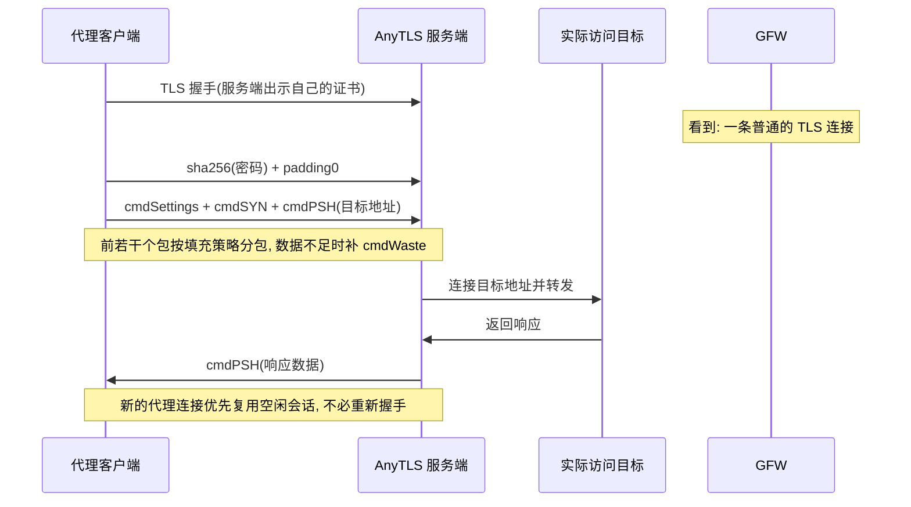
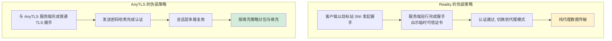
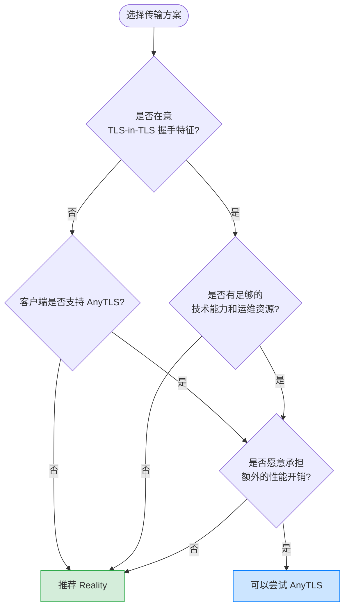

> **摘要**：AnyTLS 是一个针对 TLS-in-TLS 检测问题提出的代理协议。与 Reality 由服务端自行完成握手、并把未通过认证的连接转发给目标网站不同，AnyTLS 不借用任何网站的身份：客户端与 AnyTLS 服务端（使用服务端自己的证书）完成一次普通的 TLS 握手并用密码认证，之后在 TLS 之上运行带帧格式的会话层，用可配置的分包与填充策略打乱内层握手的长度特征，并通过连接复用降低延迟。两者代表了两种截然不同的抗检测哲学。本文深入解析 AnyTLS 的工作原理、技术优劣势、与 Reality 的对比，以及实际部署中的选择建议。

## TLS-in-TLS 问题回顾

在讨论 AnyTLS 之前，需要先理解它试图解决的核心问题。

当代理客户端通过 TLS 隧道访问一个 HTTPS 网站时，会出现一个结构性问题：外层是客户端与代理服务器之间的 TLS 连接，内层是客户端通过代理访问目标网站时产生的 TLS 连接。这就是所谓的 **TLS-in-TLS**——加密隧道内部嵌套了另一层加密隧道。

问题在于，内层 TLS 握手的数据包有非常明显的长度和时序特征。GFW 的深度包检测（DPI）系统虽然无法解密外层 TLS 的内容，但可以通过分析加密数据包的长度序列来推断内部是否嵌套了另一个 TLS 会话。如果一条"普通的 HTTPS 连接"内部持续出现符合 TLS 握手模式的数据包长度分布，审查者就有理由怀疑这是一条代理连接。

现有的应对方案包括 Xray 的 `xtls-rprx-vision`（通过对内层握手包进行 padding 来打破长度特征）和 Reality（服务端自行完成 TLS 握手，让外层连接看起来属于一个真实网站）。而 [AnyTLS](https://github.com/anytls/anytls-go) 提供了第三种思路：它本身就是一个跑在 TLS 之上的独立代理协议，在会话层用可配置、可由服务端随时更换的分包与填充策略，打乱内层握手的长度特征。

## AnyTLS 是什么

AnyTLS 是由 [anytls 项目](https://github.com/anytls/anytls-go)提出的一种代理协议，官方的 anytls-go 是它的参考实现。按项目 README 的说法，它试图缓解嵌套的 TLS 握手指纹（TLS in TLS）问题，特点是灵活的分包和填充策略、连接复用（降低代理延迟）以及简洁的配置。它和 Reality 都想让代理流量更难被识别，但采用的方法截然不同。

**Reality 的思路**是在 TLS 握手阶段做文章——客户端以目标站的 SNI 发起握手，REALITY 服务端自己以 TLS 1.3 服务端身份完成握手，向通过认证的客户端出示由「临时认证密钥」签发的「临时可信证书」；未通过认证的连接（包括主动探测）则被转发到目标网站，看到的是目标站的真证书。握手成功后，代理数据只在客户端与你的服务器之间传输。

**AnyTLS 的思路**则是在 TLS 内部的流量形态上做文章——它不借用任何网站的身份，也不与任何「目标网站」建立连接。客户端与 AnyTLS 服务端完成一次普通的 TLS 握手，服务端出示的是它自己的证书；之后客户端用密码认证，再在 TLS 之上运行一个带帧格式的会话层，按填充策略对前若干个数据包进行分包和填充。

简单来说：Reality 处理的是「这条 TLS 连接看起来属于谁」，AnyTLS 处理的是「TLS 里面跑的流量长什么样」。

## 核心工作原理

AnyTLS 的运作过程可以分为以下几个阶段。

### 第一阶段：TLS 握手与认证

客户端与 AnyTLS 服务端建立一条标准的 TLS 连接，服务端出示的是它自己的证书（参考实现默认使用自签证书）。AnyTLS 的协议参数本身不包括 TLS 参数，证书、SNI、客户端指纹等都在各实现的 TLS 配置里单独设定。握手完成后，客户端立即发送认证请求：密码的 SHA-256 哈希（32 字节），加上一段长度可变的填充 padding0。服务端校验失败时，会关闭连接或回落（fallback）到 HTTP 服务。

### 第二阶段：会话复用

认证通过后，双方进入会话层。会话中的每一帧由命令（1 字节）、streamId（4 字节）、数据长度（2 字节）和数据组成：客户端开启新会话时先发送 `cmdSettings`（上报版本、客户端名称和填充策略的 MD5），每条代理连接用 `cmdSYN` 打开一个 stream，第一个 `cmdPSH` 携带 SOCKS 地址格式的目标地址，之后用 `cmdPSH` 传数据、`cmdFIN` 关闭；UDP 则借助 sing-box 的 udp-over-tcp v2 传输。客户端必须复用会话：新建会话前先检查有没有空闲会话，按照「优先复用最新的会话，优先清理最老的会话」的原则管理，这样后续的代理连接就不必再走一次 TLS 握手，延迟更低。

### 第三阶段：分包、填充与转发

填充策略（padding scheme）按客户端写入的包序号定义。以默认策略为例，`stop=8` 表示只处理第 0 到第 7 个包，第 0 个包是认证包，之后每个包按策略规定的长度范围切分；用户数据不够时用 `cmdWaste` 帧补足，接收方读完后直接丢弃。客户端先使用默认策略，服务端发现客户端上报的 MD5 与自己不同时，会通过 `cmdUpdatePaddingScheme` 下发新策略。服务端读出目标地址后，向实际目标发起连接并转发数据。

### 与传统代理的关键区别

传统的 TLS 代理（如 Trojan、VLESS + TLS）在握手完成后，直接在 TLS 里传输原始代理数据。虽然外层 TLS 加密使内容不可见，但通过代理访问 HTTPS 网站时，内层 TLS 握手的长度和时序会透过外层的记录长度显现出来。

AnyTLS 的不同之处在于会话层的分包与填充：前若干个包被切成策略规定的长度，并插入填充帧，使内层 ClientHello 等握手消息的长度不再直接对应外层记录的长度；而且策略可以由服务端随时更换。它不改变外层是一条普通 TLS 连接的事实，也不伪装成某个特定网站。

## AnyTLS 与 Reality 的深度对比

AnyTLS 和 Reality 都是为了让代理流量不被 GFW 识别，但它们的技术哲学有着根本性的差异。理解这些差异，才能在实际部署中做出正确的选择。

### 伪装层次不同

| 维度 | Reality | AnyTLS |
|------|---------|--------|
| **处理重点** | 外层 TLS 握手（借用真实网站的身份、抵抗主动探测） | TLS 内部的流量形态（内层握手长度） |
| **证书使用** | 服务端自行完成握手，向通过认证的客户端出示「临时可信证书」；未通过认证的连接被转发到目标站，看到的是真证书 | 服务端自己的证书（由 TLS 配置决定，参考实现默认自签） |
| **与目标站的关系** | 为每条连接拨号目标站作参考，认证通过后不再与其交换数据 | 不连接任何目标站 |
| **数据传输阶段** | VLESS 等代理数据（加密），可配合 Vision 处理内层握手 | 带帧格式的会话层，按填充策略分包、填充，并复用连接 |
| **认证失败时** | 连接被转发到目标站 | 关闭连接或回落到 HTTP 服务 |

### 抗检测能力对比

**Reality 的检测风险**：

Reality 在 TLS 握手阶段的伪装非常完整——SNI 指向真实网站、客户端指纹由 uTLS 模拟浏览器、主动探测者会被转发到目标站并拿到真证书。但握手完成后，连接进入数据传输阶段时，流量内容完全是代理数据。如果 GFW 在握手后对流量进行深度统计分析（比如比较与同一目标站正常流量的差异），理论上存在被识别的可能性。此外，长时间保持连接但几乎不与 dest 站点进行 HTTP 数据交换，这种行为模式本身也可能引起关注。

**AnyTLS 的检测风险**：

AnyTLS 的优势在于内层握手的长度特征被分包与填充打乱，而且填充策略可以随时更换。但它也有自身的风险：外层就是一条普通的 TLS 连接，服务端证书、SNI 与服务器 IP 能否经得起审视，完全取决于你自己的部署；官方 [FAQ](https://github.com/anytls/anytls-go/blob/main/docs/faq.md) 列出的已知弱点还包括：TLS over TLS 比普通 h2 请求需要更多握手往返、下行流量没有处理、TLS 握手后的第一个 RTT 内常有三个以上的包几乎同时发出、额外开销使包长整体偏大且缺少小包；此外服务端不是 HTTP 服务器，仍然可能存在主动探测问题。

### 设计哲学的差异

可以用一个比喻来理解两者的区别：

- **Reality** 像是在一栋知名大楼门口安排了一位只认暗号的接待员。门卫（GFW）看到的是有人在拜访这栋知名大楼；说对暗号的人被领进你自己的房间，说不出暗号的人则被直接引到大楼真正的前台，看到的一切都是真的。但进入房间后，你的行为与大楼本身无关。如果有人跟踪你在楼内的活动，可能会发现异常。

- **AnyTLS** 像是开了一家普通的店，门面就是你自己的，不冒充任何人。它的功夫在于进出货物的打包方式：把货物按不同尺寸重新分装、塞进填充物，让门外的人无法从箱子大小判断里面装的是什么。但门面本身是否可疑，需要你自己打理。

## 优势分析

### 加密与外观交给成熟的 TLS 实现

AnyTLS 不自己设计加密，加密完全由外层 TLS 负责，这也是它名字的由来。证书、SNI、ClientHello 指纹等都交给 sing-box、mihomo 等实现的 TLS 配置处理，因此可以直接复用它们已有的 uTLS 指纹、ECH 等能力。

### 可更换的流量特征

填充策略不是写死在协议里的：默认策略只是一个示例，服务端可以通过 `cmdUpdatePaddingScheme` 把新策略推给客户端。官方 FAQ 的看法是，实现成本低、又容易改变的流量特征，更有可能达到阻碍审查研究的目的。

### 缓解 TLS-in-TLS 握手指纹

传统的 TLS 代理在加密隧道内传输的数据可能包含内层 TLS 握手的特征性包长度序列。AnyTLS 用分包与填充策略打乱前若干个包的长度，使内层 TLS 握手的长度特征不再直接暴露。需要注意这是「缓解」而不是「消除」：官方 FAQ 也承认，TLS over TLS 的额外开销仍会让包长整体偏大、缺少小包。

### 连接复用

多条代理连接共用同一个会话，新连接优先复用空闲会话，不必每次都重新完成 TLS 握手和认证，从而降低代理延迟。

## 劣势与局限

### 外层身份需要自己处理

AnyTLS 不借用任何网站的身份，服务端证书和客户端的 SNI 都由你自己配置。anytls-go 的示例服务端和客户端默认采用不安全的配置（自签证书，并假设不会遭遇 TLS 中间人攻击），日常使用应换成 sing-box、mihomo 等实现并正确配置证书。如果想隐藏 SNI，mihomo 文档建议搭配 ECH、ShadowTLS 等方案，同时明确表示不支持 AnyTLS + Reality 的组合。

与 Reality 把未通过认证的连接转发给真实网站不同，AnyTLS 认证失败时只会关闭连接或回落到 HTTP 服务，抵抗主动探测的能力取决于这部分的配置。

### 性能开销

填充帧本身就是额外的流量，会话层的帧头也有少量开销。不过填充只作用于开头的若干个包，连接复用还能减少新建 TLS 连接的次数，日常使用中的流量和延迟开销会被摊薄。

相比之下，Reality 在握手完成后就不再与 dest 站点交换数据，数据传输阶段的开销与普通 TLS 代理几乎一致。

### 部署复杂度

AnyTLS 的基本配置其实很简单：服务端只需要监听地址、密码和 TLS 证书，客户端填写服务器地址、密码和 SNI，不需要像 Reality 那样挑选目标站、生成密钥对。真正的门槛在于填充策略：默认策略只是示例，官方无法保证默认参数不被墙；想自定义策略，就要理解它的语法和对流量形态的影响。

### 成熟度与生态

作为一个相对较新的项目，AnyTLS 的生态系统远不如 Reality 成熟。Reality 已经集成在 [Xray-core](https://github.com/XTLS/Xray-core) 中，被大量面板和管理工具支持，社区经验丰富，故障排查资料也相对充足。AnyTLS 在这些方面还处于早期阶段，遇到问题时可参考的资源有限。官方的 anytls-go 也明确定位为参考实现，目标是演示协议细节，而不是提供生产级客户端，日常使用推荐 sing-box、mihomo 等第三方实现。

## 客户端支持

目前 AnyTLS 的客户端支持情况如下：

| 客户端 | 支持状态 | 备注 |
|--------|---------|------|
| [sing-box](https://github.com/SagerNet/sing-box) | 已支持 | 1.12.0 起提供 AnyTLS 入站与出站，包含服务端和客户端 |
| [Clash.Meta / mihomo](https://github.com/MetaCubeX/mihomo) | 已支持 | 包含服务端和客户端，配置见 [mihomo 文档](https://wiki.metacubex.one/config/proxies/anytls/)；不支持与 Reality 组合 |
| Shadowrocket / Stash / Loon | 已支持 | Shadowrocket 2.2.65 起；anytls-go 未验证这些客户端对规范细节的处理 |
| Xray-core | 不支持 | Xray 使用自己的 Reality 方案 |
| V2Ray | 不支持 | 无集成计划 |

需要注意的是，AnyTLS 的客户端支持范围远小于 Reality。如果你使用的客户端不支持 AnyTLS，那么 Reality 仍然是更务实的选择。

## AnyTLS 与 Reality：如何选择

这两种方案并不是简单的"谁更好"的关系，而是适用于不同场景和需求。

### 推荐使用 Reality 的场景

- **多数用户的默认选择**：如果你没有特殊的抗检测需求，Reality 已经足够安全，且客户端兼容面和社区资料都远多于 AnyTLS。
- **需要广泛客户端兼容的场景**：Reality 被几乎所有主流客户端支持，不用担心兼容性问题。
- **追求稳定性的场景**：Reality 已经过多年大规模部署和多轮 GFW 升级的考验，长期表现有更多实际经验可以参考。
- **运维资源有限的场景**：Reality 不需要自己购买域名、配置证书，社区经验丰富，遇到问题容易找到解决方案。

### 可以考虑 AnyTLS 的场景

- **在意 TLS-in-TLS 特征，又主要使用 mihomo / sing-box 系客户端**：AnyTLS 的分包与填充策略专门针对内层握手长度，且策略可以由服务端随时更换。
- **技术探索和研究**：如果你对代理技术的前沿发展感兴趣，AnyTLS 代表了一种值得关注的新方向。
- **愿意自己处理外层身份**：AnyTLS 不提供 Reality 那样的「借用真实网站身份」和对主动探测的转发，证书、SNI 以及是否搭配 ECH 等都要自己决定，确保你有足够的技术能力和时间。

### 决策参考

## 常见问题

### Q: AnyTLS 是否已经经过实战验证？

AnyTLS 作为一个相对较新的项目，其实战经验远不如 Reality 丰富。Reality 自发布以来已经经历了多轮 GFW 升级的考验，社区积累了大量的部署和调优经验。AnyTLS 的长期抗检测表现还需要时间和更多用户的实际使用来验证。在生产环境中，建议将 AnyTLS 作为备选方案而非唯一方案。

### Q: AnyTLS 能和 VLESS 搭配使用吗？

通常不会这样用。AnyTLS 本身就是一个完整的代理协议：自带密码认证、目标地址格式和多路复用，在 [sing-box](https://github.com/SagerNet/sing-box) 和 [mihomo](https://github.com/MetaCubeX/mihomo) 中都是独立的入站 / 出站类型，而不是可以套在 VLESS 外面的传输层。它可以调整的是外层 TLS，比如证书、SNI、客户端指纹，或者按 mihomo 文档的建议搭配 ECH、ShadowTLS 来隐藏 SNI。协议细节建议参考 [anytls-go 的协议文档](https://github.com/anytls/anytls-go/blob/main/docs/protocol.md)。

### Q: AnyTLS 需要像 Reality 那样选目标站吗？

不需要。AnyTLS 不连接任何目标站，服务端出示的是自己的证书，所以也不存在「目标站被封、代理跟着受影响」的问题。需要关心的是服务器 IP 本身是否被封，以及主动探测者连上来时会看到什么样的证书和响应。如果你想要的是借用大网站 TLS 身份的效果，那是 Reality 的思路，可以参考 [VLESS + Reality 深度解析](/posts/vless-reality-deep-dive/) 和 [如何选择 SNI 伪装目标](/posts/sni-target-selection/)。

### Q: AnyTLS 和 NaiveProxy 有什么区别？

两者都想让代理流量更难被识别，但实现路径不同。NaiveProxy 使用 Chromium 的网络栈来生成流量，从协议栈层面确保流量特征与真实浏览器一致。AnyTLS 则不模拟浏览器，而是在自己的会话层用分包与填充策略处理内层握手的长度特征（官方 FAQ 把 naiveproxy 列为流量形态与分类研究方面的参考项目）。NaiveProxy 的方案更"彻底"但部署更复杂（需要编译 Chromium 组件），AnyTLS 的方案相对轻量，但官方 FAQ 也坦承它在下行流量、发包时序等方面还有未处理的弱点。

## 相关链接

- [anytls-go](https://github.com/anytls/anytls-go) - AnyTLS 协议的参考实现
- [AnyTLS 协议文档](https://github.com/anytls/anytls-go/blob/main/docs/protocol.md) - 认证、帧格式与填充策略的规范
- [sing-box](https://github.com/SagerNet/sing-box) - 包含 AnyTLS 服务端与客户端
- [mihomo](https://github.com/MetaCubeX/mihomo) - 包含 AnyTLS 服务端与客户端
- [Xray-core](https://github.com/XTLS/Xray-core) - VLESS + Reality 的主要实现
- [REALITY](https://github.com/XTLS/REALITY) - Reality 协议项目
